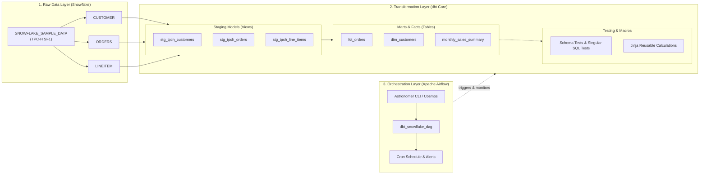

# Production-Grade ELT Pipeline (Snowflake + dbt + Airflow)

[](https://www.python.org/)
[](https://www.getdbt.com/)
[](https://www.snowflake.com/)
[](https://airflow.apache.org/)
[](https://orbstack.dev/)
[](https://vvanurag.github.io/ELT_pipeline/)

A comprehensive, production-ready **Extract, Load, Transform (ELT)** data pipeline demonstrating modern data engineering architecture, role-based access control (RBAC), dimensional modeling, data quality testing, and scheduled orchestration.

---

## Architecture Overview



---

## Tech Stack & Tooling

| Component | Tool / Platform | Purpose |
| :--- | :--- | :--- |
| **Data Warehouse** | [Snowflake](https://www.snowflake.com/) | Cloud storage, virtual compute (`COMPUTE_WH`), and secure RBAC (`TRANSFORM_ROLE`). |
| **Transformations** | [dbt Core](https://docs.getdbt.com/) (`dbt-snowflake`) | Modular SQL data models, lineage tracking, Jinja macros, and schema validations. |
| **Orchestration** | [Apache Airflow](https://airflow.apache.org/) / [Astronomer Cosmos](https://astronomer.github.io/astronomer-cosmos/) | Automatic DAG rendering from dbt project, task dependency scheduling, and monitoring. |
| **Container Engine** | [OrbStack](https://orbstack.dev/) | Fast, lightweight macOS container runtime for local Docker & Airflow execution. |
| **Documentation** | [MkDocs Material](https://squidfunk.github.io/mkdocs-material/) | Interactive static documentation site published via GitHub Pages. |

---

## Project Structure

```text
ELT_pipeline/
├── README.md                      # Project overview & architectural guide
├── mkdocs.yml                     # Documentation configuration (GitHub Pages)
├── docs/                          # Comprehensive Markdown learning & architecture guides
│   ├── index.md                   # Home & executive summary
│   ├── setup/
│   │   ├── snowflake.md           # Snowflake RBAC & DWH setup SQL
│   │   └── local_environment.md   # OrbStack, Conda & dbt setup
│   ├── concepts/
│   │   ├── elt_vs_etl.md          # Architectural patterns
│   │   └── dimensional_modeling.md# Kimball methodology, Facts & Dimensions
│   └── orchestration/
│       └── airflow_cosmos.md      # Astro & Cosmos configuration
├── dbt_project/                   # dbt transformation models
│   ├── dbt_project.yml
│   ├── packages.yml
│   ├── models/
│   │   ├── staging/
│   │   └── marts/
│   ├── macros/
│   └── tests/
└── airflow/                       # Airflow orchestration project (Docker/Astro)
    ├── Dockerfile
    └── dags/
```

---

## Quickstart

### 1. Activate Local Python Environment
```bash
conda activate elt_env
dbt --version
```

### 2. Verify Snowflake Connection
```bash
cd dbt_project
dbt debug
```

### 3. Run Pipeline Transformations & Tests
```bash
dbt run
dbt test
```

### 4. Run Orchestration with Docker & Astro CLI
```bash
cd airflow
astro dev start
```
Airflow UI will be available at `http://localhost:8080`.

