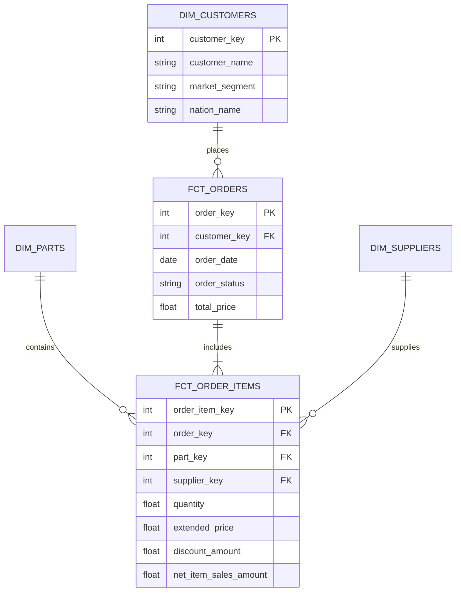

# Dimensional Modeling: Kimball Methodology

Dimensional modeling is a database design technique pioneered by Ralph Kimball aimed at optimizing databases for analytics, reporting, and BI readability.

---

## 🏛️ Star Schema Architecture

In dimensional modeling, business processes are represented through **Facts** and **Dimensions** arranged in a Star Schema:

---

## 🔑 Core Concepts

### 1. Fact Tables
* **What they represent:** Numeric measurements, metrics, and business events (e.g., an order placed, a transaction processed, an item shipped).
* **Characteristics:** High row volume, deep table, primarily composed of foreign keys linking to dimensions and numerical additive metrics (e.g., `gross_item_sales_amount`, `tax_amount`).
* **Grain:** The fundamental level of detail represented by a single row (e.g., *one row per line item on an order*).

### 2. Dimension Tables
* **What they represent:** Contextual attributes that answer the "who, what, where, when, and why" of business events.
* **Characteristics:** Wide table with many descriptive text columns (e.g., customer segment, nation, supplier address).
* **Surrogate Keys vs Natural Keys:** Natural keys (e.g., `CUST_ID`) come from source systems; surrogate keys are generated unique integers/hashes to maintain consistency across system changes.

---

## 🏗️ dbt Modeling Layers

Our dbt project organizes dimensional models into structured layers:

1. **Sources:** Direct pointers to raw Snowflake tables (`SNOWFLAKE_SAMPLE_DATA.TPCH_SF1`).
2. **Staging (`stg_`):** 1-to-1 view wrappers on raw sources; cleans column names, casts datatypes, and trims whitespace.
3. **Intermediate (`int_`):** Joins and complex business calculations between staging models.
4. **Marts (`fct_`, `dim_`):** Business-facing fact and dimension tables ready for BI visualization.

