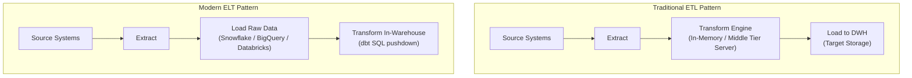

# ELT vs ETL: Architectural Paradigms

Data engineering pipelines broadly fall into two main architectural patterns: **ETL (Extract, Transform, Load)** and **ELT (Extract, Load, Transform)**.

---

## 🔄 Architectural Comparison

---

## ⚖️ Key Differences

| Dimension | Traditional ETL | Modern ELT (Our Stack) |
| :--- | :--- | :--- |
| **Transformation Location** | Dedicated processing server (e.g. Informatica, SSIS, Spark) | Inside the Cloud Data Warehouse (Snowflake) |
| **Compute Scalability** | Bound by the middle-tier processing cluster | Virtually unlimited on-demand elastic compute |
| **Raw Data Availability** | Raw data is discarded; only transformed tables are stored | Raw data is preserved indefinitely in raw/bronze schemas |
| **Agility & Changes** | Schema changes require modifying extraction code and re-ingesting | Changing transformations is as simple as updating a dbt SQL query |
| **Skill Requirements** | Proprietary GUI tools or heavy Java/Scala code | Standard SQL with Jinja templating |

---

## 🚀 Why ELT Wins in Modern Cloud Data Warehousing

1. **Storage is cheap, compute is elastic:** Cloud platforms like Snowflake decouple compute from storage. You can store petabytes of raw data at low cost and spin up compute clusters only when transformations execute.
2. **dbt Pushdown Optimization:** dbt does not move data out of Snowflake. Instead, it compiles SQL `SELECT` statements into DDL/DML (`CREATE VIEW AS`, `CREATE TABLE AS`) executed directly inside Snowflake.
3. **Data Democratization:** Analysts and analytics engineers write standard SQL rather than depending on specialized data infrastructure engineers for every schema adjustment.
