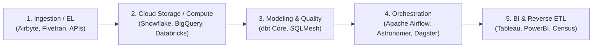

# Modern Data Stack (MDS)

The Modern Data Stack represents the evolution of data infrastructure towards modular, cloud-first, and API-driven tools.

---

## 🏗️ Core Layers of the Modern Data Stack

---

## 🌟 Benefits of the Modern Data Stack
1. **Decoupled Architecture:** Each component can be upgraded, replaced, or scaled independently without rewriting the entire pipeline.
2. **Software Engineering Best Practices:** Version control (Git), automated testing (CI/CD), environment isolation (Dev/Staging/Prod), and code reviews.
3. **Declarative Modeling:** You write the desired state of your data models in SQL/YAML; dbt figures out the execution order via directed acyclic graphs (DAGs).

