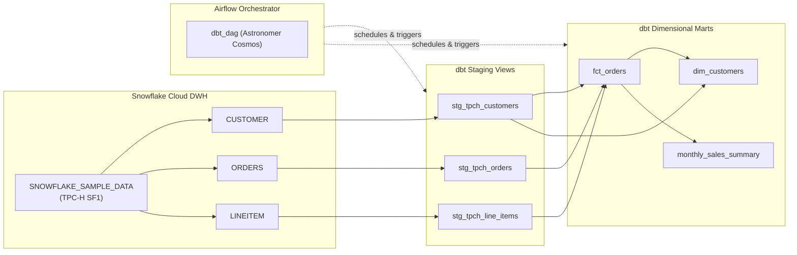

# Welcome to the ELT Pipeline Engineering Portal

This documentation portal captures the architectural principles, configuration guides, data modeling practices, and operations for our **Production-Grade ELT Data Pipeline** built with **Snowflake**, **dbt Core**, and **Apache Airflow**.

---

## 🎯 Project Objective

To build, test, and orchestrate an enterprise-grade ELT pipeline that transforms raw relational data into clean, business-ready dimensional marts while adhering to modern data engineering best practices:

1. **Role-Based Access Control (RBAC):** Principle of least privilege within Snowflake.
2. **Modular Transformations:** Staging, Intermediate, Facts, and Marts using dbt Core.
3. **Data Quality Automation:** Out-of-the-box schema assertions and custom singular SQL tests.
4. **Cloud-Native Orchestration:** Astronomer Cosmos integrating dbt graph lineage dynamically inside Apache Airflow.
5. **Reproducible Infrastructure:** Containerized runtime using Docker and OrbStack on Apple Silicon macOS.

---

## 📐 End-to-End Pipeline Lineage

---

## 📚 Learning Resources

[Video Walkthrough: ELT in 1 Hour](tutorials/elt_pipeline_video_walkthrough.md){ .md-button .md-button--primary }
[Data Engineering Architectures & Tooling](tutorials/data_engineering_architectures_and_tooling.md){ .md-button }

### Video Walkthrough: Table of Contents

1. [The Big Picture](tutorials/elt_pipeline_video_walkthrough.md#the-big-picture)
    - ELT vs ETL: transform inside the warehouse
    - Why the video uses the TPC-H sample data
2. [Lesson 1: Setting Up Snowflake and dbt](tutorials/elt_pipeline_video_walkthrough.md#lesson-1-setting-up-snowflake-and-dbt) (1:35–7:52)
    - Warehouse, database, schema and role
    - Separating compute from storage
    - RBAC grants and least privilege
    - `profiles.yml` vs `dbt_project.yml`
3. [Lesson 2: dbt Project Config and Packages](tutorials/elt_pipeline_video_walkthrough.md#lesson-2-dbt-project-config-and-packages) (7:52–11:45)
    - Materializations: view vs table
    - Folder-level config
    - Packages: `dbt_utils` and `dbt deps`
4. [Lesson 3: Sources and Staging Models](tutorials/elt_pipeline_video_walkthrough.md#lesson-3-sources-and-staging-models) (11:45–17:41)
    - `source()` vs hard-coded table names
    - What the staging layer is for
    - Grain and surrogate keys
    - Source tests
5. [Lesson 4: Transformed Models and Macros](tutorials/elt_pipeline_video_walkthrough.md#lesson-4-transformed-models-and-macros) (17:41–24:23)
    - Layers: intermediate, fact and mart
    - `ref()` and the DAG
    - Aggregating before joining
    - Macros, Jinja and DRY
6. [Lesson 5: Generic and Singular Tests](tutorials/elt_pipeline_video_walkthrough.md#lesson-5-generic-and-singular-tests) (24:23–29:35)
    - Tests return bad rows
    - Generic tests in YAML
    - Singular tests in SQL
    - `severity: warn` and `dbt build`
7. [Lesson 6: Deploying with Airflow](tutorials/elt_pipeline_video_walkthrough.md#lesson-6-deploying-with-airflow) (29:35–end)
    - Why orchestrate
    - Astro CLI and Docker
    - A separate virtual environment for dbt
    - Cosmos: one Airflow task per model
    - Airflow connections and DAG settings
8. [Key Takeaways](tutorials/elt_pipeline_video_walkthrough.md#key-takeaways)
    - [Gotchas in the Notion code](tutorials/elt_pipeline_video_walkthrough.md#gotchas-in-the-notion-code)
9. [Homework](tutorials/elt_pipeline_video_walkthrough.md#homework)
10. [Self-Check Questions](tutorials/elt_pipeline_video_walkthrough.md#self-check-questions)

---

## 🧭 Navigation Guide

- [Snowflake Setup & RBAC](setup/snowflake.md): Step-by-step SQL script to configure databases, schemas, warehouses, and roles.
- [Local Environment & OrbStack](setup/local_environment.md): Setting up Conda, Python 3.11, dbt, and OrbStack.
- [ELT vs ETL Architecture](concepts/elt_vs_etl.md): Why modern data platforms favor ELT over traditional ETL.
- [Dimensional Modeling](concepts/dimensional_modeling.md): Kimball methodology, star schemas, fact tables, and dimension tables.

