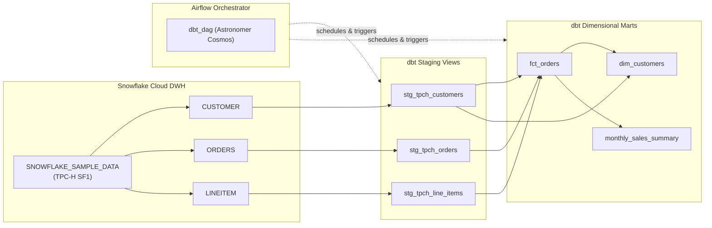

# Welcome to the ELT Pipeline Engineering Portal

This documentation portal captures the architectural principles, configuration guides, data modeling practices, and operations for our **Production-Grade ELT Data Pipeline** built with **Snowflake**, **dbt Core**, and **Apache Airflow**.

---

## 🎯 Project Objective

To build, test, and orchestrate an enterprise-grade ELT pipeline that transforms raw relational data into clean, business-ready dimensional marts while adhering to modern data engineering best practices:

1. **Role-Based Access Control (RBAC):** Principle of least privilege within Snowflake.
2. **Modular Transformations:** Staging, Intermediate, Facts, and Marts using dbt Core.
3. **Data Quality Automation:** Out-of-the-box schema assertions and custom singular SQL tests.
4. **Cloud-Native Orchestration:** Astronomer Cosmos integrating dbt graph lineage dynamically inside Apache Airflow.
5. **Reproducible Infrastructure:** Containerized runtime using Docker and OrbStack on Apple Silicon macOS.

---

## 📐 End-to-End Pipeline Lineage

---

## 🧭 Navigation Guide

- [Snowflake Setup & RBAC](setup/snowflake.md): Step-by-step SQL script to configure databases, schemas, warehouses, and roles.
- [Local Environment & OrbStack](setup/local_environment.md): Setting up Conda, Python 3.11, dbt, and OrbStack.
- [ELT vs ETL Architecture](concepts/elt_vs_etl.md): Why modern data platforms favor ELT over traditional ETL.
- [Dimensional Modeling](concepts/dimensional_modeling.md): Kimball methodology, star schemas, fact tables, and dimension tables.

