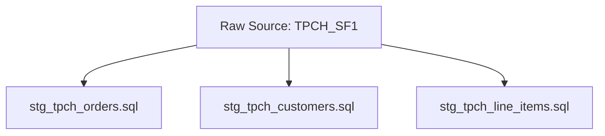

# Staging Layer Models

The staging layer acts as the foundational abstraction layer above raw Snowflake sources.

---

## 🎯 Purpose of Staging
- **Clean Column Names:** Convert uppercase or obscure source column names (`O_ORDERKEY`, `C_CUSTKEY`) into standard snake_case identifiers (`order_key`, `customer_key`).
- **Data Type Casting:** Explicitly cast strings, floats, and timestamps.
- **Deduplication & Trimming:** Remove whitespace and handle nulls consistently.
- **Lightweight Views:** Staging models are materialized as `view` rather than physical tables to save storage and ensure fresh source reads.

---

## 📄 Staging Models Overview

