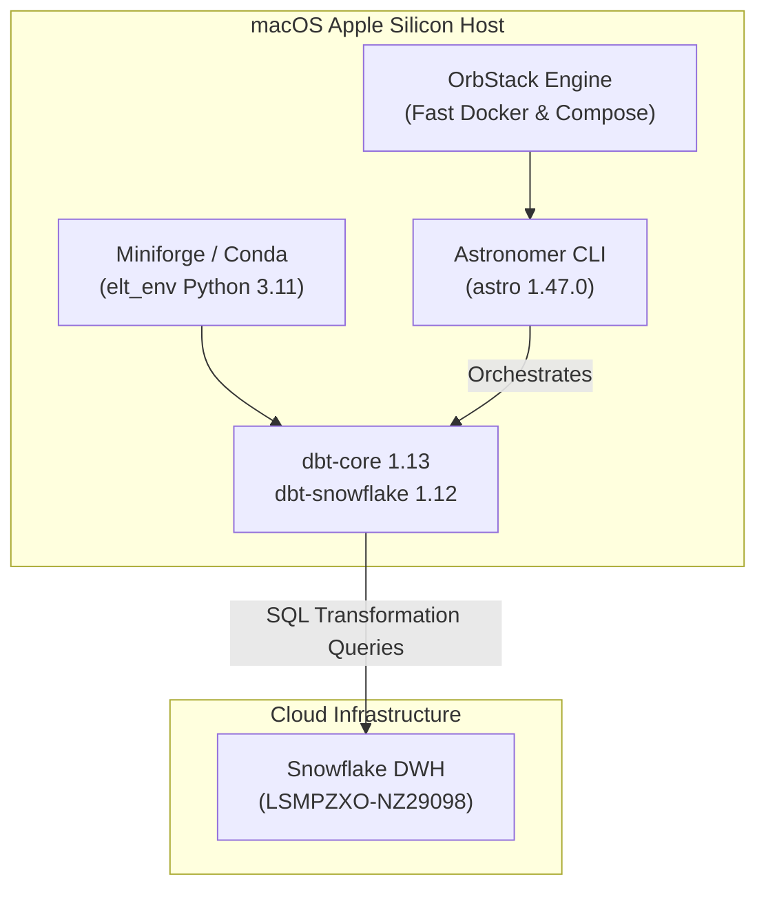

# Local Environment & Tooling Setup

This document outlines the setup procedure for the local engineering environment on macOS (Apple Silicon).

---

## 🛠️ Tooling Architecture



---

## 1. Conda Environment (`elt_env`)
We run an isolated Python 3.11 environment to ensure package stability and avoid system library collisions:

```bash
# Create environment
conda create -n elt_env python=3.11 -y

# Activate environment
conda activate elt_env

# Install dbt with Snowflake adapter
pip install dbt-snowflake
```

---

## 2. OrbStack (Docker Engine)
We use [OrbStack](https://orbstack.dev/) for container management:
* **Speed:** Starts in under 2 seconds.
* **Low Resource Usage:** Uses up to 80% less memory and CPU than Docker Desktop.
* **CLI Native:** Native drop-in for `docker` and `docker compose`.

Commands to verify:
```bash
docker --version
docker ps
```

---

## 3. Astronomer CLI (`astro`)
Astronomer CLI manages local Apache Airflow containers tailored for data engineering:

```bash
astro version
```

---

## 4. Documentation Site (MkDocs Material)
Build and preview the live documentation site locally:

```bash
# Install dependencies
pip install mkdocs-material mkdocs-mermaid2-plugin

# Run local preview server
mkdocs serve
```
Open `http://localhost:8000` in your browser.

