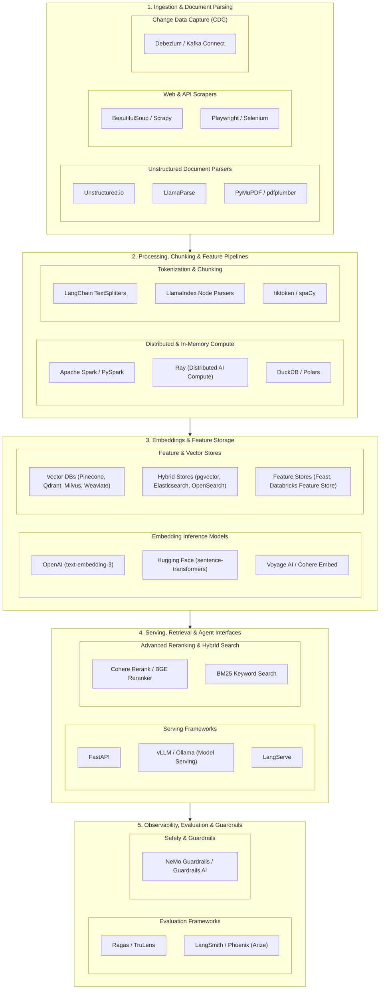
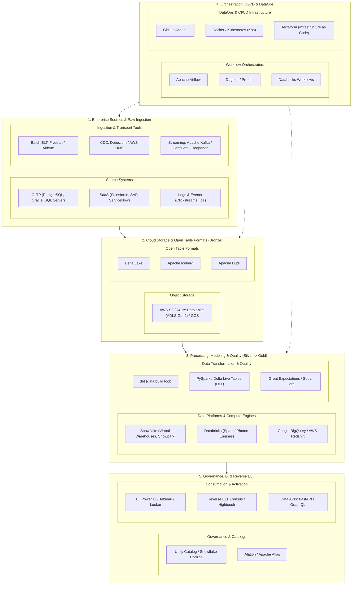

# Data Engineering & AI Engineering: Architecture, Tooling, and Frameworks

This guide provides a comprehensive reference mapping the tools, frameworks, environments, and libraries across data engineering stages for both **AI & Generative AI Systems** and **Enterprise IT / Lakehouse Architectures**.

---

## 1. Architectural Foundations: ETL vs. ELT

```
ETL (Traditional)
[ Sources ] ──> [ Extract ] ──> [ Transform (Spark / Airflow) ] ──> [ Load into DWH ]

ELT (Modern Cloud)
[ Sources ] ──> [ Extract ] ──> [ Load (Object Storage / Lake) ] ──> [ Transform inside Warehouse / Lakehouse ]
```

| Dimension | ETL (Extract, Transform, Load) | ELT (Extract, Load, Transform) |
| :--- | :--- | :--- |
| **Compute Engine** | Dedicated external compute engine (Informatica, Talend, custom Spark cluster). | Cloud Data Platform (Snowflake Virtual Warehouses, Databricks Spark/Photon, BigQuery). |
| **Storage Strategy** | Only transformed / modeled data reaches the final analytical warehouse. | Raw data lands immediately in object storage or data tables. |
| **Flexibility** | Rigid. Schema changes require modifying extraction & transformation code. | High. Raw data is preserved, allowing re-processing and retrospective queries. |
| **Speed to Ingest** | Slower (bottlenecked by transformation stage). | Rapid (bulk ingestion happens first). |
| **Compliance / Privacy** | Anonymization/masking happens *before* landing in storage. | Masking/RBAC/governance applied at transformation or via row/column policies. |
| **Modern Stack** | Spark, PySpark, Airflow (orchestration). | Fivetran/Airbyte (Extract/Load) + dbt/SQL/Spark (Transform). |

---

## 2. Modern Cloud Platforms: Snowflake vs. Databricks

```
┌────────────────────────────────────────────────────────┐
│                      dbt / SQL / BI                    │
└───────────────┬────────────────────────┬───────────────┘
                │                        │
       ┌────────▼────────┐      ┌────────▼────────┐
       │    Snowflake    │      │   Databricks    │
       │ Virtual Whs     │      │ Apache Spark    │
       │ Dynamic Tables  │      │ Delta Live Tabs │
       │ Snowpark        │      │ Unity Catalog   │
       └────────┬────────┘      └────────┬────────┘
                │                        │
       ┌────────▼────────────────────────▼────────┐
       │   Cloud Object Storage (S3 / GCS / Azure)│
       │          Open Formats (Delta / Iceberg)  │
       └──────────────────────────────────────────┘
```

| Feature | Snowflake | Databricks |
| :--- | :--- | :--- |
| **Core Heritage** | Cloud-native Data Warehouse (SaaS, SQL-first). | Managed Apache Spark / Lakehouse (code-first, Python/Scala). |
| **Architecture** | Separated storage and multi-cluster shared compute (Virtual Warehouses). | Lakehouse architecture using Delta Lake format on your cloud storage buckets. |
| **Transformation Paradigm** | SQL, Dynamic Tables, Streams & Tasks, Snowpark (Python/DataFrames). | Spark SQL, PySpark, Delta Live Tables (DLT). |
| **Open Formats** | Proprietary micro-partitions, full read/write support for Apache Iceberg. | Delta Lake (Linux Foundation open source standard). |
| **Data Governance** | Horizon Catalog (built-in tags, masking policies, row access policies). | Unity Catalog (centralized governance across data, AI models, and files). |
| **Best Suited For** | Enterprise analytics, SQL reporting, BI dashboards, low operational overhead. | Heavy transformations, machine learning, unstructured data, complex streaming, end-to-end AI/ML. |

---

## 3. The Medallion Architecture (Bronze → Silver → Gold)

```
[ Raw Sources ]
       │ (APIs, Databases, Event Streams)
       ▼
┌──────────────────┐
│   BRONZE LAYER   │  Raw, append-only ingestion with source metadata
│   (Raw / Staging)│  (timestamps, source origins, raw JSON payloads).
└────────┬─────────┘
         │  Cleaning, deduplication, schema enforcement, filtering
         ▼
┌──────────────────┐
│   SILVER LAYER   │  Enriched, cleaned, standardized enterprise data model
│   (Cleansed)     │  (conformed dimensions, parsed customer details, valid records).
└────────┬─────────┘
         │  Aggregations, business metrics, star schemas (Fact / Dimension)
         ▼
┌──────────────────┐
│    GOLD LAYER    │  Consumption-ready data for BI, reporting,
│   (Curated)      │  ML feature stores, and RAG retrieval indexes.
└──────────────────┘
```

---

## 4. Flowchart 1: Data Engineering for AI & Generative AI (LLMs, RAG & MLOps)

This pipeline illustrates how unstructured and semi-structured enterprise data flows into vector databases, feature stores, and real-time inference endpoints for AI applications.



### AI Pipeline Stage Breakdown

| Stage | Key Objective | Primary Technologies |
| :--- | :--- | :--- |
| **1. Parsing & Extraction** | Convert messy PDFs, markdown, HTML, and audio into machine-readable text while keeping metadata intact. | `Unstructured.io`, `LlamaParse`, `PyMuPDF`, `Playwright`, `Debezium` |
| **2. Processing & Chunking** | Parallel preprocessing and semantic splitting (fixed-size, markdown-aware, or token-based). | `Ray`, `PySpark`, `Polars`, `LangChain Splitters`, `tiktoken` |
| **3. Embeddings & Stores** | Transform clean text tokens into high-dimensional vectors and index them for similarity search. | `sentence-transformers`, `Pinecone`, `Qdrant`, `pgvector`, `Feast` |
| **4. Serving & Retrieval** | Expose fast API query endpoints, combine semantic search with BM25 keyword search, and apply reranking. | `FastAPI`, `vLLM`, `Cohere Rerank`, `LangServe` |
| **5. Observability & Guardrails** | Track token costs, monitor context hallucination, and prevent prompt injection before sending prompts to the LLM. | `LangSmith`, `Ragas`, `NeMo Guardrails`, `Phoenix` |

---

## 5. Flowchart 2: Data Engineering in the IT Enterprise (Modern Lakehouse & BI)

This pipeline represents the enterprise IT data lifecycle: ingesting relational OLTP databases and SaaS apps, landing them in object storage, structuring them with Medallion architecture, and serving downstream business intelligence.



### Enterprise Pipeline Stage Breakdown

| Stage | Key Objective | Primary Technologies |
| :--- | :--- | :--- |
| **1. Enterprise Ingestion** | Extract transactional records, operational tables, and change feeds with low source disruption. | `Fivetran`, `Airbyte`, `Apache Kafka`, `Debezium`, `AWS DMS` |
| **2. Storage & Open Formats** | Persist uncompressed raw files with ACID transaction guarantees, time travel, and unified metadata. | `AWS S3`, `ADLS Gen2`, `Delta Lake`, `Apache Iceberg` |
| **3. Compute, Modeling & Quality** | Execute SQL/Python transformations to build dimensional models (Star Schemas) with automated test validation. | `Snowflake`, `Databricks`, `dbt`, `PySpark`, `Great Expectations` |
| **4. Orchestration & DataOps** | Coordinate dependency graphs (DAGs), automate testing with Git version control, and provision infrastructure. | `Apache Airflow`, `Dagster`, `GitHub Actions`, `Terraform`, `Docker` |
| **5. Governance & BI Serving** | Centralize role-based access control (RBAC), feed executive dashboards, and push data back into operational tools (CRMs). | `Power BI`, `Tableau`, `Unity Catalog`, `Snowflake Horizon`, `Census` |

---

## 6. Enterprise IT vs. AI Data Engineering Comparison

| Dimension | Enterprise IT Data Engineering | AI & GenAI Data Engineering |
| :--- | :--- | :--- |
| **Primary Data Type** | Structured / Tabular (Relational, JSON) | Unstructured (Text, PDFs, Audio, Images) |
| **Core Compute Task** | SQL joins, aggregations, schema mapping | Chunking, tokenization, vector inference |
| **Primary Target Store** | Data Warehouses (Snowflake, BigQuery) | Vector DBs (Qdrant, Pinecone, pgvector) |
| **SLA & Freshness** | Batch (hourly/daily) or Micro-batch | Real-time semantic retrieval (<100ms) |
| **Serving Layer** | SQL, BI Dashboards (Power BI, Tableau) | REST APIs (FastAPI) & LLM context windows |

---

## 7. FastAPI Production Pattern for Data & AI Retrieval

Minimal Production-Grade Pattern: Vector Search Service

```python
from fastapi import FastAPI, HTTPException, status
from pydantic import BaseModel, Field
from typing import List
import time

app = FastAPI(
    title="Data & Retrieval Service",
    description="Vector search & data serving endpoint for LLM/RAG pipelines",
    version="1.0.0"
)

# 1. Pydantic Request Model with Schema Validation
class SearchQuery(BaseModel):
    query_text: str = Field(..., min_length=3, description="User search query")
    top_k: int = Field(default=5, ge=1, le=50, description="Number of results to retrieve")
    filter_source: str | None = Field(default=None, description="Optional metadata filter")

# 2. Response Model
class DocumentChunk(BaseModel):
    chunk_id: str
    content: str
    similarity_score: float
    source: str

class SearchResponse(BaseModel):
    results: List[DocumentChunk]
    execution_time_ms: float

# 3. Healthcheck Endpoint (Essential for K8s / Cloud Deployments)
@app.get("/healthz", status_code=status.HTTP_200_OK)
def health_check():
    return {"status": "healthy", "timestamp": time.time()}

# 4. Search Retrieval Endpoint
@app.post("/v1/retrieve", response_model=SearchResponse)
async def retrieve_context(payload: SearchQuery):
    start = time.perf_counter()
    try:
        # Connect to Vector DB (Pinecone / Milvus / pgvector)
        mock_results = [
            DocumentChunk(
                chunk_id="doc_101_chunk_3",
                content="Snowflake handles dynamic tables through declarative SQL pipelines.",
                similarity_score=0.91,
                source="snowflake_docs"
            )
        ]
        duration = (time.perf_counter() - start) * 1000
        return SearchResponse(results=mock_results, execution_time_ms=round(duration, 2))
    except Exception as exc:
        raise HTTPException(
            status_code=status.HTTP_500_INTERNAL_SERVER_ERROR,
            detail=f"Retrieval failed: {str(exc)}"
        )
```
