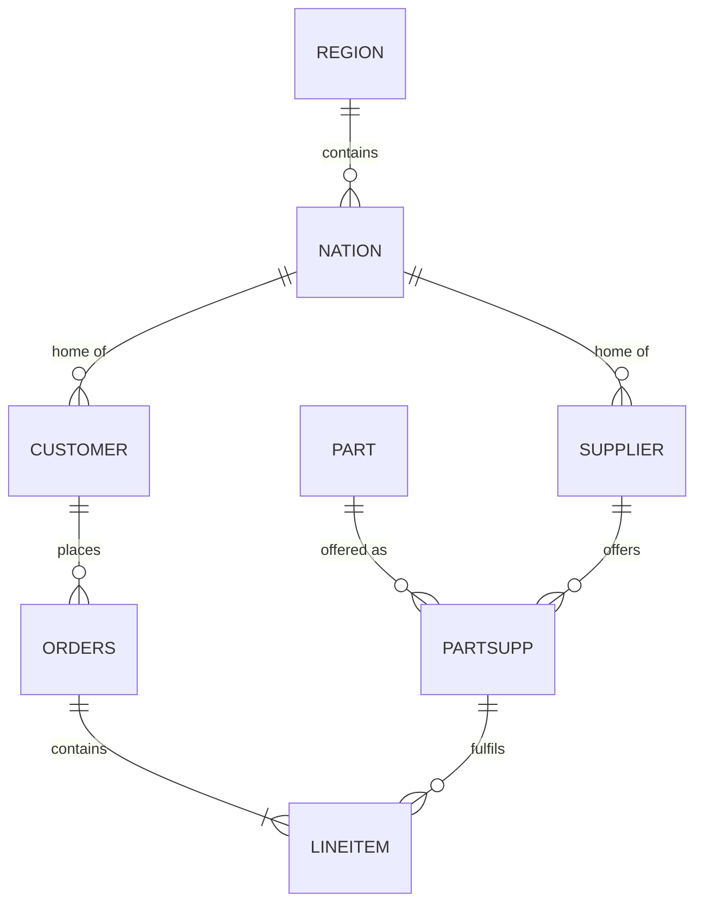

# SQL and Data Modeling: Study Guide

Topic 1 of the learning path. Every data engineering role, from a dbt analytics engineer to an AI engineer building RAG pipelines, rests on two skills:

1. **SQL**: reading, reshaping and checking data correctly and efficiently.
2. **Data modeling**: deciding which tables should exist, what one row means, and how tables relate.

All examples run on the Snowflake sample data you already used in the [ELT walkthrough](elt_pipeline_video_walkthrough.md): `SNOWFLAKE_SAMPLE_DATA.TPCH_SF1`.

```sql
use warehouse dbt_wh;
use schema snowflake_sample_data.tpch_sf1;
```

> **How to study this page:** Run every query. Before you run it, guess the row count or the result. A wrong guess teaches more than reading does. Exercise answers are hidden, so try each one first.

---

## Table of Contents

1. [The TPC-H Schema](#the-tpc-h-schema)
2. [Lesson 1: How a Query Actually Runs](#lesson-1-how-a-query-actually-runs)
    - Logical execution order
    - `NULL` and three-valued logic
3. [Lesson 2: Joins and the Fan-Out Trap](#lesson-2-joins-and-the-fan-out-trap)
    - Inner, left, semi and anti joins
    - Why joins duplicate rows
4. [Lesson 3: Aggregation](#lesson-3-aggregation)
    - `GROUP BY` and `HAVING`
    - Conditional aggregation
5. [Lesson 4: CTEs and Readable SQL](#lesson-4-ctes-and-readable-sql)
6. [Lesson 5: Window Functions](#lesson-5-window-functions)
    - Ranking, `QUALIFY` and deduplication
    - `LAG` / `LEAD` and running totals
    - Window frames
7. [Lesson 6: OLTP vs OLAP and Normalization](#lesson-6-oltp-vs-olap-and-normalization)
8. [Lesson 7: Dimensional Modeling in Practice](#lesson-7-dimensional-modeling-in-practice)
    - The four-step design process
    - Fact table types and additivity
    - Star vs snowflake schema
    - The date dimension
9. [Lesson 8: Slowly Changing Dimensions](#lesson-8-slowly-changing-dimensions)
    - SCD Type 1 and Type 2
    - SCD2 in plain SQL and with dbt snapshots
10. [Lesson 9: Other Modeling Approaches](#lesson-9-other-modeling-approaches)
    - Kimball vs Inmon vs Data Vault vs One Big Table
    - How modeling maps onto Medallion layers
11. [Lesson 10: SQL Performance in Snowflake](#lesson-10-sql-performance-in-snowflake)
12. [Practice Problems](#practice-problems)
13. [Key Takeaways](#key-takeaways)
14. [Homework](#homework)
15. [Self-Check Questions](#self-check-questions)

---

## The TPC-H Schema

TPC-H is a fake wholesale supplier. At scale factor 1 (`TPCH_SF1`) the tables are:

| Table | Rows (SF1) | One row is… | Key |
|---|---|---|---|
| `REGION` | 5 | a world region | `r_regionkey` |
| `NATION` | 25 | a country | `n_nationkey` |
| `CUSTOMER` | 150,000 | a customer | `c_custkey` |
| `SUPPLIER` | 10,000 | a supplier | `s_suppkey` |
| `PART` | 200,000 | a product | `p_partkey` |
| `PARTSUPP` | 800,000 | a part offered by a supplier | (`ps_partkey`, `ps_suppkey`) |
| `ORDERS` | 1,500,000 | an order header | `o_orderkey` |
| `LINEITEM` | ~6,000,000 | one line on an order | (`l_orderkey`, `l_linenumber`) |



This is a **normalized (3NF) source schema**, the kind an operational application writes to. A large part of data modeling is turning a schema like this into one that analysts can query easily. That is Lesson 7.

**Revenue in TPC-H** is always `l_extendedprice * (1 - l_discount)`. You will use it constantly.

---

## Lesson 1: How a Query Actually Runs

### Logical execution order

You *write* SQL starting with `SELECT`, but the database *evaluates* it in a different order:

```
1. FROM / JOIN     build the input rows
2. WHERE           filter individual rows
3. GROUP BY        collapse rows into groups
4. HAVING          filter groups
5. Window funcs    compute OVER (...) on the remaining rows
6. QUALIFY         filter on window results (Snowflake, BigQuery, Databricks)
7. SELECT          compute output columns
8. DISTINCT        remove duplicate output rows
9. ORDER BY        sort
10. LIMIT          cut
```

This order explains most "why doesn't this work?" errors:

- You can't use an aggregate in `WHERE` (`where count(*) > 5`), because grouping hasn't happened yet. Use `HAVING`.
- You can't filter on a window function in `WHERE`, because windows run after `WHERE`. Use `QUALIFY` or wrap the query in a CTE.

> **Snowflake quirk:** Snowflake lets you reference a `SELECT` alias in `WHERE`, `GROUP BY` and `HAVING`. Most databases don't, so don't depend on it if your SQL needs to be portable.

### `NULL` and three-valued logic

`NULL` means "unknown", not "empty" or "zero". Any comparison with `NULL` is neither true nor false. It is `NULL`, and `WHERE` keeps only rows where the condition is **true**.

```sql
select
    null = null          as a,   -- NULL, not TRUE
    null <> 1            as b,   -- NULL
    null is null         as c,   -- TRUE
    count(*)             as d,   -- counts rows
    count(null)          as e    -- 0: count(col) skips NULLs
;
```

Rules to memorize:

| Situation | Behaviour |
|---|---|
| `col = NULL` | Never true. Use `col IS NULL`. |
| `count(*)` vs `count(col)` | `count(*)` counts rows. `count(col)` counts non-NULL values. |
| `sum`, `avg`, `min`, `max` | Ignore NULLs. `avg` of (10, NULL) is 10, not 5. |
| `NOT IN (subquery)` | If the subquery returns **any** NULL, the result is empty. Use `NOT EXISTS`. |
| `col <> 'X'` | Silently drops rows where `col` is NULL. |
| `coalesce(a, b, 0)` | First non-NULL value. |
| `a IS DISTINCT FROM b` | NULL-safe "not equal": treats two NULLs as equal. |

The `NOT IN` trap catches experienced engineers:

```sql
-- Returns 0 rows, even though 1 is not in the list
select 1 where 1 not in (select 2 union all select null);
```

**Check yourself**

- **Q1.** Why does `select ... where count(*) > 1` fail, and what do you write instead?

---

## Lesson 2: Joins and the Fan-Out Trap

### Join types

| Join | Keeps | Typical use |
|---|---|---|
| `INNER JOIN` | Rows that match on both sides | Orders with their customer |
| `LEFT JOIN` | All left rows, plus matches (NULLs if none) | Customers and their orders, if any |
| `FULL OUTER JOIN` | All rows from both sides | Reconciling two systems |
| `CROSS JOIN` | Every combination | Calendar × product scaffolds |
| **Semi join** (`EXISTS`) | Left rows that have **at least one** match, **without duplicating** them | "Customers who ordered" |
| **Anti join** (`NOT EXISTS`) | Left rows with **no** match | "Customers who never ordered" |

```sql
-- Anti join: customers with no orders
select c.c_custkey, c.c_name
from customer c
where not exists (
    select 1 from orders o where o.o_custkey = c.c_custkey
);
-- 50,000 rows: in TPC-H, every customer whose key is divisible by 3 has no orders
```

The same result with a `LEFT JOIN`:

```sql
select c.c_custkey, c.c_name
from customer c
left join orders o on o.o_custkey = c.c_custkey
where o.o_orderkey is null;
```

> **Classic bug:** putting a filter on the right-hand table in `WHERE` turns a `LEFT JOIN` into an `INNER JOIN`.
>
> ```sql
> -- Wrong: drops customers with no 1995 orders
> from customer c left join orders o on o.o_custkey = c.c_custkey
> where year(o.o_orderdate) = 1995
>
> -- Right: filter inside the join condition
> from customer c left join orders o
>   on o.o_custkey = c.c_custkey and year(o.o_orderdate) = 1995
> ```

### The fan-out trap

When you join a "one" table to a "many" table, each "one" row is repeated once per match. That's correct. The bug happens when you then **sum a column from the "one" side**:

```sql
-- WRONG: o_totalprice is repeated once per line item, so it is overcounted ~4x
select sum(o.o_totalprice)
from orders o
join lineitem l on l.l_orderkey = o.o_orderkey;

-- RIGHT: sum at the grain the column lives at
select sum(o_totalprice) from orders;
```

Compare the two numbers. The fix is always the same: **aggregate the "many" side down to the grain of the "one" side before joining**. That's exactly why `int_order_items_summary` exists in the ELT walkthrough.

Before any join, ask: *what is the grain of each side, and what will the grain of the result be?*

**Check yourself**

- **Q2.** You join `customer` (150k rows) to `orders` (1.5M rows) with a `LEFT JOIN`. Roughly how many rows come out, and why isn't it exactly 1.5M?

---

## Lesson 3: Aggregation

### `GROUP BY` and `HAVING`

```sql
-- Revenue per market segment, only segments above 40B
select
    c.c_mktsegment,
    count(distinct o.o_orderkey)                    as orders,
    sum(l.l_extendedprice * (1 - l.l_discount))     as revenue
from customer c
join orders   o on o.o_custkey  = c.c_custkey
join lineitem l on l.l_orderkey = o.o_orderkey
group by c.c_mktsegment
having revenue > 40e9
order by revenue desc;
```

Every column in `SELECT` must be either in `GROUP BY` or inside an aggregate. Snowflake also supports `group by all`, which groups by every non-aggregated column. It's handy, but be explicit in production models.

### Conditional aggregation

This is one of the most useful patterns in analytics SQL. It pivots categories into columns in a single pass:

```sql
select
    year(o_orderdate)                                         as order_year,
    count(*)                                                  as total_orders,
    count_if(o_orderstatus = 'F')                             as fulfilled,
    sum(case when o_orderpriority = '1-URGENT' then 1 else 0 end) as urgent,
    round(100 * avg(iff(o_orderstatus = 'F', 1, 0)), 1)       as pct_fulfilled
from orders
group by order_year
order by order_year;
```

`count_if` and `iff` are Snowflake shorthands. `sum(case when ... then 1 else 0 end)` works everywhere.

**Check yourself**

- **Q3.** Why does `avg(iff(condition, 1, 0))` give a percentage?

---

## Lesson 4: CTEs and Readable SQL

A **CTE** (`with name as (...)`) names an intermediate result. Use one CTE per logical step, the same way dbt uses one model per step:

```sql
with
line_revenue as (           -- step 1: one row per line item, with revenue
    select
        l_orderkey,
        l_extendedprice * (1 - l_discount) as revenue
    from lineitem
),
order_revenue as (          -- step 2: aggregate to the order grain
    select l_orderkey, sum(revenue) as order_revenue
    from line_revenue
    group by l_orderkey
),
final as (                  -- step 3: attach order attributes
    select o.o_orderkey, o.o_orderdate, o.o_custkey, r.order_revenue
    from orders o
    join order_revenue r on r.l_orderkey = o.o_orderkey
)
select * from final;
```

Style rules that keep SQL maintainable:

- One CTE per step, named for what it **contains** (`order_revenue`), not what it does (`step2`).
- End with `final` and `select * from final`. This is the dbt convention and makes debugging easy: swap `final` for any other CTE name to inspect it.
- Prefer CTEs to nested subqueries. Correlated subqueries in `SELECT` are hard to read and often slow.
- Lowercase keywords or uppercase keywords, either is fine, but be consistent. Use trailing or leading commas consistently too.

---

## Lesson 5: Window Functions

A window function computes a value **across related rows without collapsing them**. `GROUP BY` turns many rows into one. `OVER (...)` keeps every row and adds a column.

```
function(...) over (
    partition by <which rows belong together>
    order by     <order inside each partition>
    rows between <frame>        -- optional
)
```

### Ranking, `QUALIFY` and deduplication

| Function | Ties | Example output |
|---|---|---|
| `row_number()` | Arbitrary tie-break, always unique | 1, 2, 3, 4 |
| `rank()` | Same rank, then a gap | 1, 2, 2, 4 |
| `dense_rank()` | Same rank, no gap | 1, 2, 2, 3 |

**Latest order per customer:** the most common window query in interviews and in real pipelines:

```sql
select o_custkey, o_orderkey, o_orderdate, o_totalprice
from orders
qualify row_number() over (
    partition by o_custkey
    order by o_orderdate desc, o_orderkey desc   -- tie-breaker makes it deterministic
) = 1;
```

The same pattern **deduplicates** raw data in a staging or Silver layer: partition by the business key, order by load time descending, keep row 1.

Without `QUALIFY` (Postgres, SQL Server, MySQL), wrap it:

```sql
with ranked as (
    select *, row_number() over (partition by o_custkey order by o_orderdate desc) as rn
    from orders
)
select * from ranked where rn = 1;
```

### `LAG` / `LEAD` and running totals

```sql
with monthly as (
    select
        date_trunc('month', o_orderdate) as month,
        sum(o_totalprice)                as revenue
    from orders
    group by month
)
select
    month,
    revenue,
    lag(revenue) over (order by month)                              as prev_month,
    round(100 * (revenue / lag(revenue) over (order by month) - 1), 2) as mom_growth_pct,
    sum(revenue) over (
        partition by year(month)
        order by month
        rows between unbounded preceding and current row
    )                                                               as ytd_revenue,
    avg(revenue) over (
        order by month
        rows between 2 preceding and current row
    )                                                               as rolling_3m_avg
from monthly
order by month;
```

### Window frames

When you add `ORDER BY` to an aggregate window and **don't** specify a frame, most databases default to `RANGE BETWEEN UNBOUNDED PRECEDING AND CURRENT ROW`. With `RANGE`, rows that tie on the `ORDER BY` value are all included together, so a "running total" jumps by several rows at once on duplicate dates. **Always write `ROWS BETWEEN ...` explicitly** for running totals.

**Check yourself**

- **Q4.** You need the top 3 parts by revenue in each nation, and ties should all be included. Which ranking function do you use?

---

## Lesson 6: OLTP vs OLAP and Normalization

| | OLTP (operational) | OLAP (analytical) |
|---|---|---|
| Purpose | Run the business: place an order | Understand the business: revenue by region |
| Workload | Many small reads and writes of single rows | Few large scans and aggregations |
| Design goal | No duplicated data, fast consistent writes | Simple, fast reads |
| Modeling | Normalized (3NF) | Denormalized (star schema, wide tables) |
| Storage | Row-oriented (Postgres, MySQL) | Column-oriented (Snowflake, BigQuery, Databricks) |
| Example | The TPC-H source tables | `fct_orders`, `dim_customers` |

### Normal forms, briefly

Normalization removes duplicated data so each fact is stored once and updates can't create contradictions.

- **1NF:** each column holds a single atomic value; no repeating groups (no `phone1, phone2, phone3`, no comma-separated lists).
- **2NF:** 1NF, and every non-key column depends on the **whole** key. In `PARTSUPP` (key `ps_partkey, ps_suppkey`), `p_name` would violate 2NF because it depends only on `ps_partkey`, so it lives in `PART`.
- **3NF:** 2NF, and non-key columns depend **only** on the key, not on other non-key columns. `CUSTOMER` stores `c_nationkey`, not `nation_name`, because the name depends on the nation, not the customer.

The short version: *every column depends on the key, the whole key, and nothing but the key.*

### Why analytics denormalizes on purpose

To get "revenue by region" from 3NF TPC-H you need five joins: `lineitem → orders → customer → nation → region`. In a star schema `region_name` sits directly on `dim_customers`, so it's one join. Columnar storage and compression make the duplicated text cheap, and analysts can't get the joins wrong if there are fewer of them.

Normalize where data is **written**. Denormalize where data is **read**.

**Check yourself**

- **Q5.** A source table has `order_id, customer_id, customer_email, amount`. Which normal form does it break, and why?

---

## Lesson 7: Dimensional Modeling in Practice

The [Dimensional Modeling](../concepts/dimensional_modeling.md) concept page covers facts, dimensions and the star schema. This lesson is about **how to design one**.

### The four-step design process (Kimball)

1. **Pick the business process.** A verb the business performs and measures: *selling*, *shipping*, *paying*. Not a department.
2. **Declare the grain.** One sentence saying exactly what one row of the fact table means. *"One row per order line item."* This is the most important decision; everything else follows from it.
3. **Identify the dimensions.** The who, what, where and when that describe a row at that grain: customer, part, supplier, order date, ship date.
4. **Identify the facts.** The numbers measured at that grain: quantity, extended price, discount, revenue.

Applied to TPC-H sales:

| Step | Decision |
|---|---|
| Process | Order line sales |
| Grain | One row per `(l_orderkey, l_linenumber)` |
| Dimensions | `dim_customer`, `dim_part`, `dim_supplier`, `dim_date` (role-played as order, ship, commit, receipt date) |
| Facts | `quantity`, `extended_price`, `discount_amount`, `tax_amount`, `net_revenue` |

**Choose the lowest grain you can.** You can always aggregate line items up to orders, but you can never break orders back down into line items.

### Fact table types

| Type | One row per… | TPC-H example | Changes after insert? |
|---|---|---|---|
| **Transaction** | Event | `fct_order_items`: each line sold | No |
| **Periodic snapshot** | Entity per period | Customer account balance at each month end | No, a new row each period |
| **Accumulating snapshot** | Process instance with milestones | One row per line item with order, ship, commit and receipt dates, updated as each happens | Yes, updated as milestones arrive |
| **Factless** | Event with no measure | Which parts were *offered* by which supplier (`PARTSUPP` coverage) | No |

### Additivity

| Kind | Can be summed across… | Example |
|---|---|---|
| **Additive** | All dimensions | `quantity`, `net_revenue` |
| **Semi-additive** | Some dimensions, but **not time** | `c_acctbal`: summing balances across customers is fine, summing one customer's balance across 12 months is meaningless. Use the latest or average. |
| **Non-additive** | Nothing | Ratios and percentages, such as `discount` rate. Store the numerator and denominator, and compute the ratio after summing. |

The non-additive rule matters: the average of 100 per-order discount rates isn't the overall discount rate. `sum(discount_amount) / sum(gross_amount)` is.

### Star vs snowflake schema

```
        STAR                                SNOWFLAKE
dim_customer                         dim_customer
 ├ customer_name                      ├ customer_name
 ├ nation_name     ◄─ flattened       └ nation_key ──► dim_nation
 └ region_name                                          ├ nation_name
                                                        └ region_key ──► dim_region
```

Prefer a **star**: flatten `nation` and `region` into `dim_customer`. Snowflaking saves a little storage but adds joins and confusion. (The Snowflake *database* is unrelated to the snowflake *schema*.)

```sql
-- dim_customer as a star dimension
select
    c.c_custkey      as customer_key,
    c.c_name         as customer_name,
    c.c_mktsegment   as market_segment,
    n.n_name         as nation_name,
    r.r_name         as region_name
from customer c
join nation n on n.n_nationkey = c.c_nationkey
join region r on r.r_regionkey = n.n_regionkey;
```

### The date dimension

Every warehouse needs a `dim_date`. It lets analysts filter on "weekends", "fiscal Q3" or "holidays" without writing date functions every time.

```sql
with days as (
    select dateadd(day, row_number() over (order by seq4()) - 1, '1992-01-01'::date) as date_day
    from table(generator(rowcount => 2557))   -- 1992-01-01 to 1998-12-31
)
select
    to_number(to_char(date_day, 'YYYYMMDD'))  as date_key,
    date_day,
    year(date_day)                            as year,
    quarter(date_day)                         as quarter,
    month(date_day)                           as month,
    monthname(date_day)                       as month_name,
    dayofweekiso(date_day)                    as day_of_week,   -- 1 = Monday
    dayofweekiso(date_day) in (6, 7)          as is_weekend
from days;
```

`row_number()` is used instead of `seq4()` alone because Snowflake's sequence functions can leave gaps. In dbt, the `dbt_utils.date_spine` macro does this for you.

**Role-playing dimensions:** one `dim_date` table can be joined several times to the same fact, once each as order date, ship date and receipt date.

**Check yourself**

- **Q6.** Why should the grain be declared *before* choosing facts and dimensions?

---

## Lesson 8: Slowly Changing Dimensions

Dimension attributes change: a customer moves country or changes market segment. How you handle the change decides whether historical reports stay correct.

| Type | What happens | History kept? | Use when |
|---|---|---|---|
| **Type 0** | Never change the value | Original only | Birth date, original signup channel |
| **Type 1** | Overwrite the old value | No | Typo fixes; history doesn't matter |
| **Type 2** | Expire the old row, insert a new row | Full | Reports must reflect the value *at the time*, such as revenue by the segment the customer was in when they ordered |
| **Type 3** | Add a `previous_value` column | One prior value | Rare: before/after a reorganization |

### SCD Type 2 table shape

| customer_sk | customer_id | market_segment | valid_from | valid_to | is_current |
|---|---|---|---|---|---|
| 1 | 42 | BUILDING | 2024-01-01 | 2025-06-10 | false |
| 7 | 42 | AUTOMOBILE | 2025-06-10 | NULL | true |

- **`customer_sk`** is a surrogate key per *version*. Facts store the version that was current when the event happened.
- **`customer_id`** is the natural (business) key, repeated across versions.
- To find the version valid on a date: `where :date >= valid_from and (:date < valid_to or valid_to is null)`.

### SCD2 in plain SQL

Two statements in one transaction. Compare a hash of the tracked columns so the check stays one comparison however many columns you track:

```sql
begin;

-- 1. Expire the current row for customers whose tracked attributes changed
update dim_customer_scd2 d
set    valid_to = current_timestamp(), is_current = false
from   stg_customers s
where  d.customer_id = s.customer_id
  and  d.is_current
  and  d.row_hash <> s.row_hash;

-- 2. Insert a new current row for new customers and for those just expired
insert into dim_customer_scd2
    (customer_id, customer_name, market_segment, nation_name, row_hash,
     valid_from, valid_to, is_current)
select
    s.customer_id, s.customer_name, s.market_segment, s.nation_name, s.row_hash,
    current_timestamp(), null, true
from stg_customers s
left join dim_customer_scd2 d
       on d.customer_id = s.customer_id and d.is_current
where d.customer_id is null;     -- no current row: either brand new, or expired in step 1

commit;
```

where `stg_customers` computes `md5(concat_ws('|', customer_name, market_segment, nation_name)) as row_hash`, and `customer_sk` is an identity or sequence column.

### SCD2 with dbt snapshots

dbt writes the same logic for you. In dbt 1.9+ snapshots are defined in YAML:

```yaml
# snapshots/customers_snapshot.yml
snapshots:
  - name: customers_snapshot
    relation: source('tpch', 'customer')
    config:
      schema: snapshots
      unique_key: c_custkey
      strategy: check
      check_cols: [c_name, c_address, c_mktsegment, c_nationkey]
```

`dbt snapshot` adds `dbt_valid_from`, `dbt_valid_to` and `dbt_scd_id` columns. Use `strategy: timestamp` with `updated_at:` when the source has a reliable last-modified column. It's cheaper than comparing columns.

**Check yourself**

- **Q7.** A customer moved from `BUILDING` to `AUTOMOBILE` in June. With SCD Type 1, what happens to the segment shown on their March orders in a revenue-by-segment report?

---

## Lesson 9: Other Modeling Approaches

| Approach | Idea | Strengths | Weaknesses |
|---|---|---|---|
| **Kimball** (dimensional) | Build star schemas per business process, linked by shared ("conformed") dimensions | Easy for analysts and BI tools; fast | Needs redesign when processes change |
| **Inmon** (enterprise DW) | Build one normalized (3NF) enterprise warehouse first, then derive marts from it | Single integrated source of truth | Slow to deliver; heavy up-front design |
| **Data Vault 2.0** | Split data into **hubs** (business keys), **links** (relationships) and **satellites** (attributes over time) | Auditable, handles many changing sources, insert-only loads | Many tables; hard to query directly, so star marts are still built on top |
| **One Big Table (OBT)** | Pre-join everything into one very wide table | Simplest possible querying; good for columnar engines and ML features | Duplicated logic across tables; hard to change grain |

In modern stacks these are layered, not exclusive.

### How modeling maps onto Medallion layers

| Medallion layer | dbt layer | Modeling style |
|---|---|---|
| **Bronze** | Sources | Raw, as loaded. Often append-only. |
| **Silver** | Staging + intermediate | Cleaned, typed, deduplicated, conformed keys. Sometimes Data Vault. |
| **Gold** | Marts (`fct_`, `dim_`) and OBTs | Kimball stars for BI; wide tables for ML and RAG features |

See the [Architectures & Tooling Reference](data_engineering_architectures_and_tooling.md#3-the-medallion-architecture-bronze-silver-gold) for more on Medallion.

---

## Lesson 10: SQL Performance in Snowflake

Snowflake stores tables in **micro-partitions** (compressed, columnar chunks of roughly 50–500 MB of uncompressed data) and keeps the min and max value of every column in every partition. Most performance work comes down to helping it **read fewer partitions and fewer columns**.

| Practice | Why |
|---|---|
| Select only the columns you need; avoid `select *` on big tables | Columnar storage reads only the referenced columns |
| Filter on columns that correlate with load order (often dates) | Lets Snowflake **prune** partitions using min/max metadata |
| Filter and aggregate **before** joining | Smaller join inputs; avoids fan-out |
| Use `QUALIFY` or `EXISTS` instead of `DISTINCT` to remove join duplicates | `DISTINCT` hides a fan-out bug and costs a sort |
| Add a **clustering key** only on very large tables that are filtered on the same column | Keeps related rows in the same partitions; it costs credits to maintain |
| Use the **Query Profile** | Shows partitions scanned vs total, spilling to disk and "exploding" joins |
| Remember the **result cache** | An identical query within 24 hours returns instantly, so don't mistake a cache hit for a fast query when benchmarking (`alter session set use_cached_result = false;`) |

Try it: run the two queries below and compare *Partitions scanned* in the Query Profile.

```sql
select count(*) from snowflake_sample_data.tpch_sf100.orders
where o_orderdate between '1995-01-01' and '1995-01-31';

select count(*) from snowflake_sample_data.tpch_sf100.orders
where o_comment like '%special%';
```

The first can prune partitions using the date's min and max; the second has to scan every partition.

**Check yourself**

- **Q8.** A dashboard query joins `orders` to `lineitem` and uses `select distinct` to "fix" duplicate rows. What is probably wrong, and what is the better fix?

---

## Practice Problems

Interview-style problems on `TPCH_SF1`. Write your own answer before opening the solution.

**P1. Top 5 nations by 1995 revenue** (customer's nation).

??? success "Solution"
    ```sql
    select n.n_name as nation, sum(l.l_extendedprice * (1 - l.l_discount)) as revenue
    from lineitem l
    join orders   o on o.o_orderkey  = l.l_orderkey
    join customer c on c.c_custkey   = o.o_custkey
    join nation   n on n.n_nationkey = c.c_nationkey
    where o.o_orderdate >= '1995-01-01' and o.o_orderdate < '1996-01-01'
    group by nation
    order by revenue desc
    limit 5;
    ```
    The date filter uses a half-open range (`>=` and `<`) on the raw column instead of `year(o_orderdate) = 1995`. That's correct for timestamps too, and it keeps partition pruning simple.

**P2. Grain check.** Prove that `(l_orderkey, l_linenumber)` is unique in `lineitem`.

??? success "Solution"
    ```sql
    select l_orderkey, l_linenumber, count(*) as n
    from lineitem
    group by 1, 2
    having count(*) > 1;
    -- 0 rows = the grain holds. This is what dbt's unique_combination_of_columns test runs.
    ```

**P3. Each customer's second-largest order** by `o_totalprice`. Skip customers with only one order.

??? success "Solution"
    ```sql
    select o_custkey, o_orderkey, o_totalprice
    from orders
    qualify row_number() over (partition by o_custkey order by o_totalprice desc, o_orderkey) = 2;
    ```
    Customers with one order have no row number 2, so they drop out on their own.

**P4. Late delivery rate by ship mode.** A line is late when `l_receiptdate > l_commitdate`.

??? success "Solution"
    ```sql
    select
        l_shipmode,
        count(*)                                        as lines,
        count_if(l_receiptdate > l_commitdate)          as late_lines,
        round(100 * late_lines / lines, 2)              as late_pct
    from lineitem
    group by l_shipmode
    order by late_pct desc;
    ```
    Note the reuse of `late_lines` and `lines` aliases, which is allowed in Snowflake but not portable.

**P5. Customers whose order count grew every year from 1993 to 1996.**

??? success "Solution"
    ```sql
    with yearly as (
        select o_custkey, year(o_orderdate) as yr, count(*) as orders
        from orders
        where o_orderdate >= '1993-01-01' and o_orderdate < '1997-01-01'
        group by 1, 2
    ),
    with_prev as (
        select *, lag(orders) over (partition by o_custkey order by yr) as prev_orders,
                  lag(yr)     over (partition by o_custkey order by yr) as prev_yr
        from yearly
    )
    select o_custkey
    from with_prev
    group by o_custkey
    having count(*) = 4                                     -- ordered in all 4 years
       and count_if(prev_orders is not null
                    and yr = prev_yr + 1
                    and orders > prev_orders) = 3;          -- grew in each of the 3 transitions
    ```

**P6. Revenue share.** For each region, what percentage of total revenue does it contribute?

??? success "Solution"
    ```sql
    with region_rev as (
        select r.r_name as region, sum(l.l_extendedprice * (1 - l.l_discount)) as revenue
        from lineitem l
        join orders   o on o.o_orderkey  = l.l_orderkey
        join customer c on c.c_custkey   = o.o_custkey
        join nation   n on n.n_nationkey = c.c_nationkey
        join region   r on r.r_regionkey = n.n_regionkey
        group by region
    )
    select region, revenue,
           round(100 * revenue / sum(revenue) over (), 2) as pct_of_total
    from region_rev
    order by revenue desc;
    ```
    `sum(...) over ()` with an empty window is the grand total, attached to every row.

**P7. Design question.** The business wants to analyse *supplier delivery performance*. Declare the grain, dimensions and facts.

??? success "Model answer"
    - **Process:** shipping a line item.
    - **Grain:** one row per line item, `(l_orderkey, l_linenumber)`.
    - **Dimensions:** `dim_supplier` (with nation and region flattened in), `dim_part`, `dim_date` role-played as ship, commit and receipt date, ship mode as a small dimension or a degenerate attribute.
    - **Facts:** `quantity`, `days_late = datediff(day, l_commitdate, l_receiptdate)`, `is_late` (0/1, so `avg(is_late)` is the late rate), `transit_days = datediff(day, l_shipdate, l_receiptdate)`.
    - This is close to an **accumulating snapshot**: the dates are milestones in one process.

---

## Key Takeaways

1. SQL is evaluated `FROM → WHERE → GROUP BY → HAVING → window → QUALIFY → SELECT → ORDER BY`. Most errors make sense once you know this.
2. `NULL` is "unknown". Use `IS NULL`, prefer `NOT EXISTS` to `NOT IN`, and know that `count(col)` skips NULLs.
3. Before every join, know the grain of both sides. Aggregate the "many" side first to avoid fan-out.
4. Window functions add a column without collapsing rows. `row_number()` + `QUALIFY` is the standard dedup and "latest per key" pattern.
5. Normalize where data is written (OLTP); denormalize where data is read (OLAP).
6. Dimensional design is: process → **grain** → dimensions → facts. Choose the lowest grain.
7. Know additive, semi-additive and non-additive facts. Never average a ratio.
8. SCD Type 2 keeps history with versioned rows and validity dates; dbt snapshots automate it.
9. In Snowflake, performance means reading fewer partitions and fewer columns.

---

## Homework

1. Build `dim_date` with the generator query, then rewrite P1 to join through `dim_date` instead of filtering on `o_orderdate`.
2. In your dbt project, add `fct_order_items` at line-item grain with `dim_part` and `dim_supplier`, and add a `dbt_utils.unique_combination_of_columns` test on the grain.
3. Create a small `stg_customers` table in your own schema, run the SCD2 SQL from Lesson 8, then `update` a customer's segment and run it again. Check that you have two versions.
4. Add a dbt snapshot on `customer`, then answer: why won't it ever capture a change on sample data, and how could you simulate one?
5. Run the two partition-pruning queries in Lesson 10 and record *partitions scanned / total* for each.

---

## Self-Check Questions

| # | Lesson | Question |
|---|---|---|
| Q1 | 1 | Why does `where count(*) > 1` fail, and what do you write instead? |
| Q2 | 2 | A `LEFT JOIN` of `customer` to `orders` returns how many rows, roughly, and why not exactly 1.5M? |
| Q3 | 3 | Why does `avg(iff(condition, 1, 0))` give a percentage? |
| Q4 | 5 | Top 3 parts by revenue per nation, ties included: which ranking function? |
| Q5 | 6 | `order_id, customer_id, customer_email, amount`: which normal form does this break? |
| Q6 | 7 | Why declare the grain before choosing facts and dimensions? |
| Q7 | 8 | With SCD Type 1, what segment do a customer's old orders show after the customer changes segment? |
| Q8 | 10 | Why is `select distinct` a red flag after a join, and what's the better fix? |

??? note "Answers"
    1. `WHERE` runs before `GROUP BY`, so no aggregates exist yet. Use `HAVING count(*) > 1`.
    2. About 1,550,000: every order matches one customer (1.5M rows), plus one NULL-padded row for each of the ~50,000 customers with no orders.
    3. The average of a column of 1s and 0s is the fraction of 1s.
    4. `dense_rank()` (or `rank()`) with `<= 3`. `row_number()` would arbitrarily drop tied parts.
    5. 3NF: `customer_email` depends on `customer_id`, a non-key column, not on `order_id`.
    6. The grain decides which dimensions apply and which facts are valid. A fact at a different grain causes fan-out or wrong totals.
    7. The new segment, `AUTOMOBILE`. Type 1 overwrites, so history is rewritten. Use Type 2 to report March under `BUILDING`.
    8. It usually hides a fan-out from joining at the wrong grain, and costs a sort. Aggregate the many side before joining, or use `EXISTS` / `QUALIFY`.
